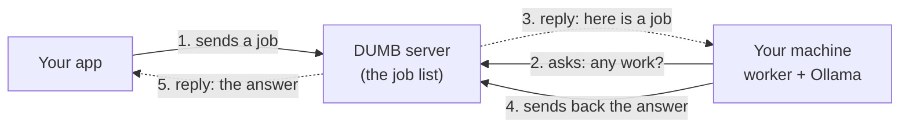
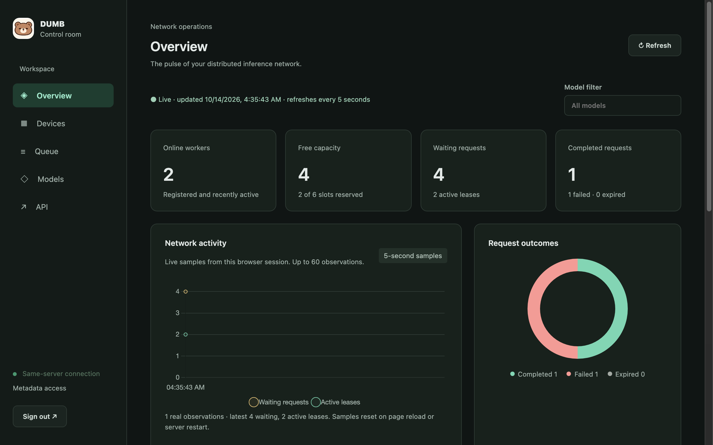

<p align="center">
  
</p>

<h1 align="center">DUMB</h1>

<p align="center">
  <strong>Distributed User-owned Model Backend</strong><br>
  Run AI requests on machines you own, wherever they are.
</p>

<p align="center">
  <a href="https://github.com/gkhntpbs/dumb/releases/latest"></a>
  <a href="https://github.com/gkhntpbs/dumb/actions/workflows/ci.yaml"></a>
  <a href="LICENSE"></a>
  <a href="go.mod"></a>
</p>

<p align="center">
  <a href="#how-it-started">Story</a> ·
  <a href="#why-dumb">Why</a> ·
  <a href="#how-it-works">How it works</a> ·
  <a href="#install-a-worker">Install</a> ·
  <a href="#the-control-room">Admin panel</a> ·
  <a href="#documentation">Docs</a> ·
  <a href="SECURITY.md">Security</a>
</p>

---

## How it started

DUMB started as a side question while I was working on Moonlet, an app that tracks the
things you're waiting for. When you share a post to Moonlet, a small language model reads
the caption and works out what the post is about. That model runs on Cloudflare Workers AI,
and it works.

Then a new kind of model came out, and I wondered whether it could do this job better. Not
quite, as it turned out. But it raised a second question: could open models running on my
own hardware do it instead?

I have the hardware, just not in one place. My machines are spread across different
locations and differ a lot in power, from a Mac mini to a desktop with an RTX 5090, and
each one runs on its own internet connection and its own electricity. The same is true
well beyond my own desk: the gaming PCs of friends on a Discord server, or office
computers that sit idle all night. So I asked whether machines like these could act as
one pool: when one goes offline the others take its share, and if they're all down,
everything falls back to the cloud setup that already works.

The problem was security. Opening machines in people's homes to the internet means running
tunnels, VPNs and access rules, and keeping all of that safe is a job I can't do on the
side. We went through the managed options, and they were reasonable, but each one still
meant letting traffic *into* those machines.

Then it flipped. Why should the machines be reachable at all? I already run a server with
a fixed domain. Put a list of jobs on it, have the machines subscribe and pick up the work,
and send the answers back. Every connection goes out from the machines, and nothing comes
in. A machine behind any home router just works, and one that loses power simply stops
asking for work.

Once it looked like that, it was clearly not a Moonlet feature. Any app of mine that needs
a model could use it, so it became its own project, and an open one: Distributed
User-owned Model Backend.

## Why DUMB

Plenty of useful AI work fits on a small local model: classifying, extracting, short
rewrites, structured JSON answers. Meanwhile the computers that could run those models —
a desktop in the studio, a Mac mini on a shelf, a Raspberry Pi next to the router — sit
idle most of the day, and every request goes to a paid cloud API instead.

Using those machines is harder than it sounds. They sit behind home routers, change
networks, go to sleep and get switched off. Exposing Ollama to the internet, opening
ports or maintaining a VPN for every box is exactly the kind of setup nobody wants to
babysit.

DUMB turns them into one backend:

- **Your application sends a job to one server**, the way it would call any API.
- **Your machines pull work** over outbound HTTPS. Nothing listens for inbound
  connections, so a worker behind any NAT just works.
- **When no worker can take the job**, DUMB says so right away (`503`), or the wait
  runs out without a result. What happens next is up to your application.

DUMB does not call any cloud AI provider itself. A pattern that works well, and the one
DUMB was built around, is to keep your existing cloud provider as a fallback in your own
code:

```text
send the job to DUMB with a short wait (e.g. ?wait=1500ms)
  200 → use the result from your own machine
  503 → call your cloud provider as before
  202 (no result in time) → cancel the DUMB job, then call your cloud provider
```

That way a request still gets answered when every machine is off; it just costs what it
used to.

The name is honest about the scope. DUMB is a deliberately simple job queue, not an
orchestrator: no scheduling magic, no shared GPU memory, no model sharding. One request,
one machine, one local model.

## How it works



Solid arrows start the connection, dotted arrows are replies on it. Your machine only ever
connects **out** to the server; nothing connects in.

- **Pull, not push.** Workers hold a long-poll open to the server. No open ports, no
  tunnels, no VPN.
- **Ollama does the inference.** The worker is a small background daemon that manages a
  local Ollama and talks to it on `127.0.0.1` only. An explicit opt-in allows an Ollama
  elsewhere on the same private network ([remote-ollama.md](docs/remote-ollama.md)).
- **Leases with deadlines.** A job is leased to one worker at a time; an unacknowledged or
  expired lease is revoked, and a worker that leaves says goodbye so callers learn at once.
- **Signed, atomic, reversible updates.** Workers update themselves from GitHub Releases;
  a binary whose minisign signature does not verify is never applied, and a bad update
  rolls back on its own.

The protocol is defined in one place: [`docs/protocol/openapi.yaml`](docs/protocol/openapi.yaml).

## Install a worker

Every release ships signed archives for Linux, macOS and Windows on
[GitHub Releases](https://github.com/gkhntpbs/dumb/releases/latest). A worker needs a
server to connect to and a one-time pairing code from that server's admin panel
(**Devices > Add worker**). The dialog prints the exact commands for each platform with
your server URL and models filled in.

<details open>
<summary><strong>Linux</strong> (VPS, Raspberry Pi 4/5, amd64 or arm64)</summary>

`install.sh` downloads the release, verifies its minisign signature and checksum with
OpenSSL, and only then installs a systemd unit.

```sh
curl -fsSLO https://raw.githubusercontent.com/gkhntpbs/dumb/main/scripts/install.sh
less install.sh   # read it first

# Current account, systemd user unit
sh install.sh -user -server https://dumb.example -models qwen3:0.6b -pair-code-stdin

# Dedicated "dumb" account, hardened system unit
sudo sh install.sh -system -server https://dumb.example -models qwen3:0.6b -pair-code-file /root/pair-code
```

Details: [linux-install.md](docs/linux-install.md), [service.md](docs/service.md).
</details>

<details>
<summary><strong>macOS</strong></summary>

Download `dumb-worker_<version>_darwin_arm64.tar.gz` (or `amd64`), then pair and install
the launchd agent:

```sh
TOKEN="$HOME/Library/Application Support/DUMB/worker-token"
./dumb-worker pair -server https://dumb.example -token-file "$TOKEN"   # asks for the code; input is hidden
./dumb-worker service install -server https://dumb.example -token-file "$TOKEN" -models qwen3:0.6b
```

The service runs `dumb-worker` from this folder, so keep the binary where it is.

The native DUMB Worker app provides first-run pairing or token setup, optional
start at login, and Pause, Resume and Quit. Download its architecture-specific
application ZIP from Releases or build locally with
`./scripts/build-macos-app.sh` ([macos-worker.md](docs/macos-worker.md)).
</details>

<details>
<summary><strong>Windows</strong></summary>

Download `dumb-worker_<version>_windows_amd64.zip`, pair from PowerShell with the commands
the Add worker dialog shows, then run `dumb-worker.exe`. First-run setup checks the
server, installs or reuses Ollama, pulls the models and starts the tray worker at sign-in.

Details: [windows-worker.md](docs/windows-worker.md).
</details>

## Run it locally

To try the whole loop on one machine with a local Ollama:

```bash
./scripts/dev.sh
```

It builds `dumb-server` and `dumb-worker`, starts both on `127.0.0.1` (model
`smollm2:135m` by default, `DEV_MODELS` to change) with throwaway tokens, and prints a
ready-to-run request:

```bash
curl -s -H "Authorization: Bearer $TOKEN" -H 'Content-Type: application/json' \
  "http://127.0.0.1:$PORT/v1/jobs?wait=5s" \
  -d '{"model":"smollm2:135m","prompt":"Reply with {\"ok\":true}","format":"json","deadline_ms":10000}'
```

Ctrl-C stops everything and deletes the temporary directory. A typed TypeScript client
lives in [`clients/typescript`](clients/typescript/README.md).

## The control room

The server ships an admin panel for the people running the network: which workers are
online and fresh, which models are available where, free job slots, queue activity and
API traffic. It shows metadata only, never request or response content. Workers are
added and re-paired from here.

<p align="center">
  
</p>

<sub>Captured on synthetic demo data.</sub>

## Status

DUMB is in active development. Tagged releases are published and real workers run on
Linux (including a Raspberry Pi), macOS and Windows, but the protocol may still change
between minor versions. Open work is tracked in [TODO.md](TODO.md).

## Documentation

| Topic | Document |
|---|---|
| Protocol (the single authority) | [protocol/openapi.yaml](docs/protocol/openapi.yaml) |
| Linux one-command install and `install.sh` | [linux-install.md](docs/linux-install.md) |
| Running the worker as a service (launchd, systemd, Windows) | [service.md](docs/service.md) |
| Windows desktop worker and tray | [windows-worker.md](docs/windows-worker.md) |
| macOS worker | [macos-worker.md](docs/macos-worker.md) |
| Pairing a worker | [worker-pairing.md](docs/worker-pairing.md) |
| Credentials and the Add worker / Re-pair flow | [credential-management.md](docs/credential-management.md) |
| Ollama on another machine of the private network | [remote-ollama.md](docs/remote-ollama.md) |
| Ollama readiness and recovery | [ollama-recovery.md](docs/ollama-recovery.md) |
| Queue limits and caller ownership | [queue-admission.md](docs/queue-admission.md) |
| Durable queue and idempotency | [durable-queue.md](docs/durable-queue.md) |
| Admin browser sessions | [admin-browser-sessions.md](docs/admin-browser-sessions.md) |
| Releases, signing and self-update | [release.md](docs/release.md) |
| Measurements | [measurements.md](docs/measurements.md) |

## Security

This repository is written to be safe while fully public: secrets, signing keys and
deployment details are never part of it. Design rules and how to report a vulnerability
are in [SECURITY.md](SECURITY.md).

## License

[MIT](LICENSE)
